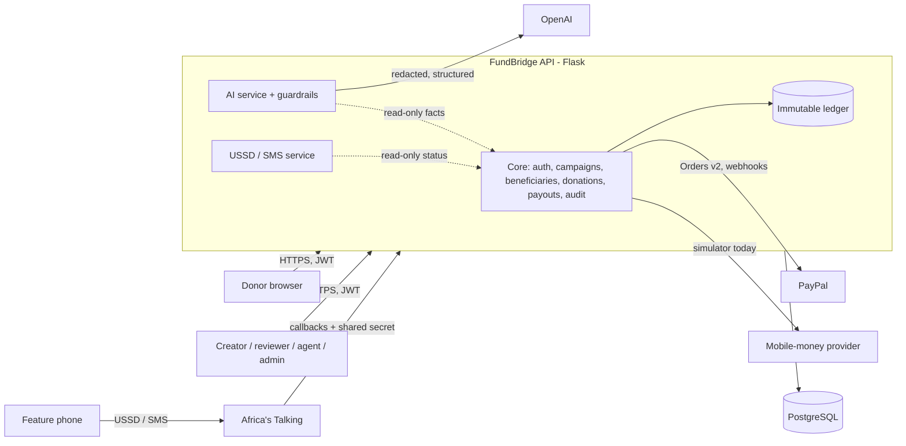

# FundBridge

FundBridge is a crowdfunding platform that lets donors anywhere give through PayPal to people who may have
no PayPal account, no bank account and no smartphone: beneficiaries in East Africa who are paid out by mobile money
and follow their campaign and payout on any phone, by USSD or SMS.

> **Current status (2026-11-11): a working backend with sandbox and simulated providers.** No real PayPal payment,
> mobile-money payout, SMS, USSD session or OpenAI request has been made yet. See
> [What is live, sandboxed or simulated](#what-is-live-sandboxed-or-simulated).

## The problem

International donors want to help a specific person: a student's school fees, a clinic roof, a farmer's seeds. The
people they want to help often cannot receive the money:

- PayPal cannot pay out to many of them, and many have no bank account. They use mobile money (such as M-Pesa) on a
  basic phone.
- They may not have a smartphone or reliable data, so a web dashboard is not enough.
- Donors need to trust that the person is real and that the money reaches them. Beneficiaries need to know, in their
  own language, whether money has actually arrived.

## How it works, donor to beneficiary

1. **Onboarding.** A community agent registers the beneficiary (name, phone, mobile-money destination). A reviewer
   verifies the profile. Changing the phone number or payout destination later sends it back for reverification.
2. **Campaign.** A creator writes the campaign, optionally with the AI draft assistant, and submits it. A reviewer
   approves or rejects it. Only approved campaigns are public.
3. **Donation.** A donor finds the campaign, by browsing or with natural-language AI search. They pay through
   **PayPal Checkout** (Orders v2). FundBridge counts the donation only after PayPal confirms it: a server-side
   capture, a signature-verified webhook, or a reconciliation that re-reads the order from PayPal. A PayPal redirect
   alone is never treated as payment.
4. **Ledger.** Every confirmed donation becomes an immutable ledger entry. Campaign totals, available funds and
   payout reservations are calculated from the ledger, never from client input or AI.
5. **Payout.** The beneficiary requests a payout. The amount is reserved in the ledger, and a reviewer approves or
   rejects the request; no one can approve their own. Approved payouts go to the verified mobile-money destination.
   *Today the payout provider is a labelled simulator, so payouts stop at "approved, being prepared".*
6. **Feature phone.** The beneficiary dials the USSD code (or sends SMS) to see their campaign total and, behind a
   4-digit PIN, their payout status. They get an SMS when a donation is confirmed or a payout changes status, in
   English or Kiswahili.

## The role of PayPal and AI

**PayPal** is the donation rail: Orders v2 create, approve and capture, plus webhooks. The server talks to PayPal and
validates the order reference, amount and currency before crediting anything. Donors need only PayPal; beneficiaries
never do.

**AI (OpenAI, behind a provider abstraction)** helps people use the payment journey. It can never change it.

| Feature | Who | What it does | Without AI |
|---|---|---|---|
| Campaign draft | creator | Turns rough notes into a reviewable title, summary and story; flags missing facts, mismatched amounts and unsafe claims | Template built from the notes, labelled as such |
| Translation | anyone | Translates campaign text for international donors (13 languages) | Unavailable (503); the original is shown |
| Campaign search | donors | Turns "help a girl finish school in Kenya" into filters over published campaigns | Keyword matching, labelled |
| Beneficiary assistant | beneficiaries, agents | Explains how campaigns, donations and payouts work, in plain language | Rule-based answers, labelled |
| Status explanation | donors, beneficiaries | Explains one donation or payout **from FundBridge's own record** (status, amount, campaign total) in the person's language | FundBridge's standard explanation in English or Kiswahili |

The AI cannot create or capture PayPal orders, write to the ledger, approve campaigns, beneficiaries or payouts,
change payout destinations, or decide that a payment succeeded. The AI modules cannot import payment, payout, ledger
or model code, and a test enforces this. Financial state shown to users always comes from backend records. Generated
text that claims money moved when the record does not say so is replaced.

## Feature-phone experience (USSD and SMS)

Built for basic phones, with no smartphone and no PayPal account needed. Every screen is GSM 7-bit text of at most
182 characters, in English or Kiswahili.

```
*384*123#  (placeholder service code; none is registered yet)
1. My campaign        status and confirmed total, from the ledger
2. My payout status   4-digit PIN (3 wrong tries = 30 min lock; admin reset) -> latest payout state
3. Find a campaign
4. How donors give
5. Get help           agent callback, report a problem, changed phone/SIM (high priority)
6. Language/Lugha
```

SMS commands: `HELP`/`MSAADA`, `STATUS`/`HALI`, `FIND`/`TAFUTA`, `AGENT`/`WAKALA`, `LANG`, `STOP`/`START`. Payout
details are never sent by SMS. Only verified beneficiary numbers get beneficiary information. Callbacks need a shared
secret, and retried callbacks are processed once. The integration is built for Africa's Talking. A browser phone
simulator, labelled as simulated, is available for demos. **The Kiswahili text awaits native-speaker review**
([`kiswahili-review.md`](docs/integration/kiswahili-review.md)).

## What is live, sandboxed or simulated

| Integration | State | Needed to go further (owner) |
|---|---|---|
| PayPal donations | **Sandbox adapter, implemented, not yet configured.** Tested only against a local PayPal Orders v2 stand-in. | Sandbox app credentials and webhook ID; then one real sandbox payment. Live needs a PayPal business account. |
| Mobile-money payouts | **Simulator.** Payouts stop at `approved_for_submission`; nothing ever reports "paid". | A licensed payout provider (for example Daraja B2C or an aggregator), contract and credentials |
| OpenAI | **Implemented, never called for real.** Tested with a mocked transport and a local stand-in. Fallbacks run without a key. | `OPENAI_API_KEY`; confirm the model (default `gpt-5.4-mini`, unverified) with `flask fundbridge-ai check` |
| SMS (Africa's Talking) | **Simulated outbox.** The Africa's Talking adapter is implemented and tested only against a local stand-in. | Account and API key; for production, KYC and a sender ID or two-way shortcode |
| USSD (Africa's Talking) | **Callback implemented, plus the simulator.** No service code registered. | USSD channel and service code (telco approval), callback URL registration, IP allowlist |
| Web frontend | **Not in this repository yet** (Cursor). The typed API client is in [`contracts/`](contracts). | Frontend branch and a browser walkthrough |

`GET /api/v1/integrations/status` and `GET /api/v1/public/config` report these modes at runtime, so the UI can label
them honestly.

## Architecture



| Component | Where | Owner |
|---|---|---|
| Core API (auth, campaigns, beneficiaries, donations, PayPal, ledger, payouts, audit) | `backend/app/api/v1/routes.py`, `backend/app/services/`, `backend/app/models/` | Codex |
| AI service, provider abstraction, guardrails | `backend/app/services/ai/`, `backend/app/integrations/ai/`, `backend/app/api/v1/ai.py` | Claude |
| USSD/SMS service, gateways, simulator | `backend/app/services/messaging/`, `backend/app/integrations/messaging/`, `backend/app/api/v1/messaging.py` | Claude |
| Operations (roles, verification, balances, hardening, CLI) | `backend/app/api/v1/operations.py`, `backend/app/integrations/` | Claude |
| Typed frontend client and contracts | `contracts/` | Claude (consumed by Cursor) |
| Web frontend | not yet published | Cursor |

## Technology

- **Backend:** Python 3.12, Flask 3, SQLAlchemy and Flask-Migrate (Alembic), Flask-JWT-Extended, PostgreSQL 14+
  (SQLite for quick trials only), gunicorn.
- **Money:** `Decimal`/`Numeric` amounts as strings in JSON; an immutable ledger; idempotency keys; row locks for
  payout reservations.
- **Providers:** PayPal REST (Orders v2, webhooks); the OpenAI Python SDK (Chat Completions with strict JSON-schema
  output); Africa's Talking SMS and USSD; pydantic for request and model-output validation.
- **Contracts:** TypeScript (strict) client and types in `contracts/`.

## Local setup

Requires Python 3.12. Full guide: [`docs/RUNBOOK.md`](docs/RUNBOOK.md) and [`docs/DEPLOYMENT.md`](docs/DEPLOYMENT.md).

```bash
cd backend
python3 -m venv .venv
.venv/bin/pip install -r requirements.txt            # add -r requirements-deploy.txt for gunicorn
cp .env.example .env                                 # set SECRET_KEY, JWT_SECRET_KEY, DATABASE_URL, MESSAGING_CALLBACK_TOKEN
set -a; . ./.env; set +a
.venv/bin/flask --app run:app db upgrade             # database migrations
.venv/bin/flask --app run:app fundbridge-admin create-admin --email you@example.org
DEMO_PASSWORD='choose-a-demo-password' .venv/bin/flask --app run:app fundbridge-demo seed   # optional demo data
MESSAGING_SIMULATOR_ENABLED=true .venv/bin/flask --app run:app run --port 5000
```

- **Demo data:** `fundbridge-demo seed` creates demo accounts for every role, two verified beneficiaries and four
  campaigns, and **no** donations, ledger entries or payouts. `--scenarios` adds demo donations and payouts labelled
  `demo_seed`; they are not payments. Production refuses to seed.
- **Phone simulator:** `http://localhost:5000/api/v1/messaging/simulator`.
- **Check a running server:** `python scripts/smoke_test.py --base-url http://localhost:5000 --password "$DEMO_PASSWORD"`.

## Environment variables

[`backend/.env.example`](backend/.env.example) lists every variable, with placeholders only, and a test checks that
every setting the app reads is listed there. The main ones:

| Variable | Purpose |
|---|---|
| `SECRET_KEY`, `JWT_SECRET_KEY`, `DATABASE_URL`, `FRONTEND_ORIGIN` | Required for any deployment |
| `PAYPAL_CLIENT_ID`, `PAYPAL_CLIENT_SECRET`, `PAYPAL_WEBHOOK_ID`, `PAYPAL_BASE_URL` | PayPal (sandbox URL by default) |
| `OPENAI_API_KEY`, `OPENAI_MODEL`, `AI_PROVIDER`, `AI_*` | AI (fallbacks without a key); `AI_DAILY_REQUEST_LIMIT` caps provider calls per day |
| `SMS_PROVIDER`, `AT_USERNAME`, `AT_API_KEY`, `AT_SENDER_ID`, `USSD_SERVICE_CODE` | Africa's Talking (`simulator` by default) |
| `MESSAGING_CALLBACK_TOKEN`, `MESSAGING_ALLOWED_IPS`, `PUBLIC_BASE_URL` | Callback security and links in SMS |
| `MESSAGING_SIMULATOR_ENABLED` | Demo phone simulator (off by default) |
| `TRUSTED_PROXY_HOPS` | Client IP behind a reverse proxy (rate limits, IP allowlist) |

## Sandbox testing

- **PayPal sandbox:** create a sandbox app and a webhook at developer.paypal.com, set the three `PAYPAL_*` values,
  donate with a sandbox buyer account, and check that the donation reaches `completed` and the campaign total rises.
- **Africa's Talking sandbox:** set `AT_USERNAME=sandbox` and the sandbox key. Messages reach Africa's Talking's
  simulator, not real phones. Register the callback URLs that `flask fundbridge-messaging check-config` prints.
- **OpenAI:** set the key and run `flask fundbridge-ai check`; `GET /api/v1/integrations/status` then reports
  `model_verified: true`.

Step-by-step procedures and the evidence to record: [`docs/integration/EXTERNAL_CHECKLIST.md`](docs/integration/EXTERNAL_CHECKLIST.md).

## Tests

```bash
cd backend
.venv/bin/python -m pytest tests -q        # unit, integration, migrations and the live e2e suite (SQLite)
POSTGRES_TEST_DATABASE_URL=postgresql+psycopg://user@host/fb_test \
E2E_DATABASE_URL=postgresql+psycopg://user@host/fb_e2e \
.venv/bin/python -m pytest tests -q        # adds PostgreSQL concurrency and the e2e suite on PostgreSQL
cd ../contracts && npm ci && npm test      # TypeScript client type-check and offline tests
```

`tests/e2e` starts the API under gunicorn and drives every role's journey over HTTP. PayPal and OpenAI are local
stand-ins there. A redacted transcript of the latest run is in [`docs/evidence/journeys.md`](docs/evidence/journeys.md).
Real-provider tests are opt-in: `FUNDBRIDGE_LIVE_OPENAI_TESTS=1 OPENAI_API_KEY=... pytest tests/ai/test_openai_live.py`.

## Deployment

See [`docs/DEPLOYMENT.md`](docs/DEPLOYMENT.md) and [`docs/RELEASE_CHECKLIST.md`](docs/RELEASE_CHECKLIST.md). In
short:

- PostgreSQL, because the payout reservation relies on row locks.
- HTTPS, and `FLASK_ENV=production`, which refuses to start without secrets.
- One gunicorn worker with threads (`-w 1 --threads 8`): rate limits and the simulated outbox are per process.
- `TRUSTED_PROXY_HOPS` set when behind a proxy.
- `flask db upgrade` on every release.

## Security and privacy

- **Secrets:** server-side only, never sent to the browser; `.env.example` holds placeholders only.
- **Sign-in:** 15-minute JWTs, sign-in throttling and account lockout. Role checks on every route.
- **Money:**
  - Idempotency keys on donations and payouts, scoped to the caller and rejected on mismatch.
  - Donations confirmed only by PayPal itself, with amount and reference checks.
  - Immutable ledger entries; row locks against double reservation.
  - No self-approval; every financial action is written to `audit_log`.
- **Beneficiary data:** phone and destination changes force reverification. Payout status on USSD needs a hashed PIN,
  with lockout. Unverified or unknown numbers get nothing beneficiary-specific. Phone numbers are masked in logs.
- **AI:**
  - Phone numbers, e-mail addresses, ID and transaction numbers are redacted before any provider call.
  - Requests are sent with `store=false` and a hashed per-user safety identifier.
  - Output is schema-validated, stripped of links and markup, and checked for unsafe claims.
  - Per-user, per-IP and daily limits apply.
- **Callbacks:** a shared secret (constant-time comparison), an optional IP allowlist, idempotent processing.
  PayPal webhooks are signature-verified with PayPal.
- **Errors:** a uniform error envelope with a request ID; error responses and logs exclude SQL parameters, tokens
  and full phone numbers.

Known limits and open items: [`docs/integration/COORDINATION.md`](docs/integration/COORDINATION.md) and
[`docs/VERIFICATION_REPORT.md`](docs/VERIFICATION_REPORT.md).
